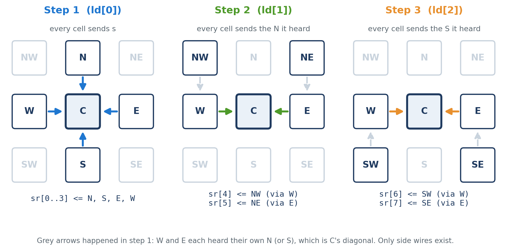
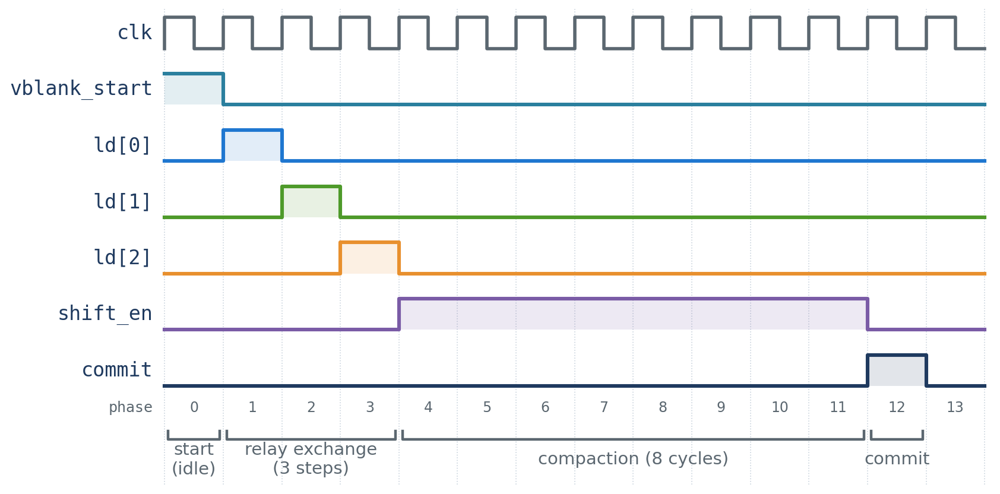
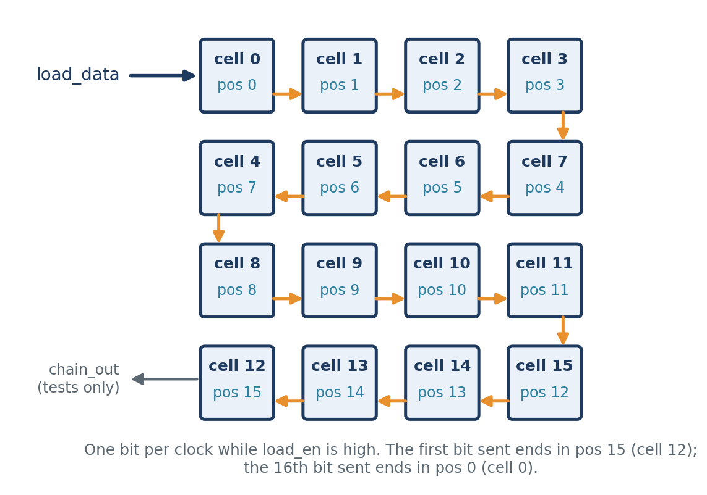

# Architecture

Conway's Game of Life on a 4×4 array of hardware cells that all compute the
next generation at the same time, drawn live on a 640×480 @ 60 Hz VGA monitor.
Target: Tiny Tapeout 26c, GF180MCU (`gf180mcuD`), one 1×1 tile.

See also: [functionality.md](functionality.md) (what it does and how to use it)
and [code_walkthrough.md](code_walkthrough.md) (the Verilog, module by module).

---

## 1. System overview


The design has two halves that meet at the read mux:

- **Game of Life core** (`golchip_core`, `src/golchip.v`) holds the 16 cells and
  computes generations.
- **VGA side** (`vga_timing.v` and the renderer in `project.v`) scans the
  screen, works out which cell is under the beam and colours the pixel.

They share one timing signal: the core only updates the grid on
`vblank_start`, when the monitor is not drawing, so the picture never tears.

| Module (file) | Responsibility | Main signals |
|---|---|---|
| `tt_um_vga_interface` (`project.v`) | Top level. Decodes the control pins, maps the beam position to a cell, colours the pixel, registers all eight video outputs. | `ui_in`, `uo_out`; `row`, `col`; `r`, `g`, `b` |
| `vga_timing` (`vga_timing.v`) | Pixel and line counters, sync pulses, active-video flag, one-cycle pulse at the start of vertical blanking. | `hpos`, `vpos`, `hsync`, `vsync`, `display_on`, `vblank_start` |
| `golchip_sequencer` (`golchip.v`) | Synchronises `step`, counts the burst of generations, runs the 12-cycle routine starting only at `vblank_start`. | `step`, `speed`, `load_en` → `ld[2:0]`, `shift_en`, `commit` |
| `golchip_grid`, `golchip_cell` (`golchip.v`) | The 16 cells, their side-neighbour wiring with a dead border, and the snake load chain. | `ld`, `shift_en`, `commit`, `load_data` → `cells[15:0]` |
| `golchip_readmux` (`golchip.v`) | Picks the one cell under the beam. | `cells`, `row`, `col` → `cell_bit` |

---

## 2. Cell grid

### 2.1 Neighbour exchange by relay (3 steps)

Every cell has **one output wire**, `link`, that goes to its four side
neighbours (N, S, E, W). There are **no diagonal wires**. Diagonal values are
passed along by a side neighbour: a cell's north-west neighbour is the north
neighbour of its west neighbour, so the west neighbour can forward it.



| Step | Every cell drives `link` with | Cell stores | Meaning |
|---|---|---|---|
| 1 (`ld[0]`) | its own state `s` | `sr[0..3] <= in_n, in_s, in_e, in_w` | the four side neighbours |
| 2 (`ld[1]`) | `sr[0]`, the N it heard in step 1 | `sr[4] <= in_w`, `sr[5] <= in_e` | W's north is my NW; E's north is my NE |
| 3 (`ld[2]`) | `sr[1]`, the S it heard in step 1 | `sr[6] <= in_w`, `sr[7] <= in_e` | W's south is my SW; E's south is my SE |

Every wire keeps exactly one driver; only what it carries changes. Which
neighbour lands in which register stage does not matter, because only the
number of 1s is used.

**Why relay.** The original design wired each cell directly to all eight
neighbours. A shared-line scheme (two cells taking turns on one wire) would
halve the lines but needs tri-state drivers or two drivers on one net, which
we understand is not available inside a Tiny Tapeout project.

| (4×4 grid) | Direct links | Shared lines | **Relay (built)** |
|---|---|---|---|
| Inputs per cell | 8 | 4 (shared) | **4** |
| Driver-to-receiver links | 84 | fewer, shared | **48** |
| Diagonal wires | yes | yes | **no** |
| Tri-states needed | no | yes | **no** |
| Exchange steps | 4 | 4 | **3** |
| Extra logic per cell | none | tri-state enables | **3:1 mux on `link`** |

### 2.2 Counting without adders

The eight neighbour bits sit in an 8-bit shift register `sr`. While `shift_en`
is high, every 1 moves one stage right whenever the stage on its right is
empty. After at most 7 cycles (8 are budgeted) the register is a thermometer
code: *k* live neighbours means the right-most *k* bits are 1.

```verilog
e            = {1'b1, sr, 1'b0};        // walls around sr
sr_packed[i] = (e[i+1] & e[i+2])         // a blocked 1 stays
             | (e[i]   & ~e[i+1]);       // an empty stage takes the 1 from its left
```

The count is then read straight off two bits:

| Condition | Test on the packed register |
|---|---|
| count ≥ 2 | `sr[6]` |
| count ≥ 3 | `sr[5]` |
| count ≥ 4 | `sr[4]` |

```verilog
exactly3 = sr[5] & ~sr[4];
exactly2 = sr[6] & ~sr[5];
next_s   = exactly3 | (s & exactly2);   // B3/S23 in three gates
```

Each cell has nine flip-flops (`s` plus the eight `sr` stages), 144 in the
grid.

### 2.3 Phase sequencing (12 cycles)



| Phase | Signal | What happens |
|---|---|---|
| 0 | — | idle; waits for `vblank_start` |
| 1–3 | `ld[0]`, `ld[1]`, `ld[2]` | relay exchange |
| 4–11 | `shift_en` | compaction (8 cycles) |
| 12 | `commit` | every `s <= next_s` at once |

All strobes are clock enables on the single system clock; there are no
derived or gated clocks.

### 2.4 Dead border

The grid builds a padded 6×6 copy of the `link` wires with a ring of constant
0s, and every cell reads its neighbours from it. Edge cells hear 0 from outside
the grid, and relayed diagonals from the border are 0 too. Patterns reaching
the edge die or settle; an all-alive grid leaves only the four corners.

---

## 3. VGA path

### 3.1 Timing (640×480 @ 60 Hz, 25.175 MHz)

| Segment | Horizontal (pixels) | Vertical (lines) |
|---|---|---|
| Active video | 640 (0–639) | 480 (0–479) |
| Front porch | 16 | 10 |
| Sync pulse (active low) | 96 (656–751) | 2 (490–491) |
| Back porch | 48 | 33 |
| Total | 800 | 525 |

Vertical blanking is 45 lines × 800 clocks = 36,000 clocks; a generation needs
12, so every commit lands in blanking.

### 3.2 Pixels to cells


The grid fills the whole screen: each cell is 160×120 pixels, so
`col = hpos / 160` and `row = vpos / 120` (constant divisors, built as fixed
logic). A 4-pixel separator is drawn where `hpos % 160` or `vpos % 120` is
below 4.

| Pixel | RR GG BB | Appearance |
|---|---|---|
| outside the active area | 00 00 00 | black |
| separator | 01 01 01 | dim grey |
| live cell | 11 11 11 | white |
| dead cell | 00 00 01 | very dark blue |

All eight `uo_out` bits, including `hsync` and `vsync`, are registered
together, so colour and sync leave the chip on the same clock edge (one clock
of latency, not visible).

### 3.3 Read mux

`cell_bit = cells[row*4 + col]`: a combinational 16:1 mux feeding the
renderer and then the output register.

---

## 4. Loading and control



- **Load chain.** While `load_en` is high, one bit per clock enters from
  `load_data` and shifts through every cell's `s` in snake order (row 0 left to
  right, row 1 right to left, …). 16 clocks load the grid. The sequencer cannot
  start and `step` is ignored while loading.
- **Step.** `step` passes through a 2-flip-flop synchroniser and an edge
  detector. Each rising edge loads a burst counter with 2^`speed` (1, 2, 4, 8);
  one generation runs per frame until it reaches 0. A new edge during a burst
  reloads the counter.
- **Reset.** `rst_n` synchronously clears every cell, register stage and the
  sequencer. `run` is reserved; `busy` and `gen_tick` exist in the core but are
  not on pins.

---

## 5. Changes from the original (v3) design document

| Area | v3 plan | As built |
|---|---|---|
| Process | SkyWater 130 nm | GF180MCU, TT 26c, 1×1 tile |
| Exchange | 8 direct links, 4 steps | relay over 4 side wires, 3 steps |
| Generation | 14 cycles | 12 cycles |
| Run control | run/pause, step, speed as frame divider | step bursts of 2^speed; `run` reserved |
| Clear | dedicated pin | removed; `rst_n` clears |
| Display | centred power-of-two block | full screen, 160×120 cells, separators |
| `uio` | debug outputs | unused |

## 6. Known issues and remaining checks

- **Area on GF180.** Cells are larger than on SKY130; check utilisation in the
  hardening report. The divide/modulo by 160 and 120 could be replaced by three
  comparisons per axis if area is tight.
- **Clock.** Confirm the demo board provides 25.175 MHz (many monitors also
  accept 25.0 MHz).
- **Gate level.** Gate-level simulation and timing/area reports from the
  GitHub Actions flow still need review.
- **Dead border.** Gliders die at the edge; wrap-around is future work.
