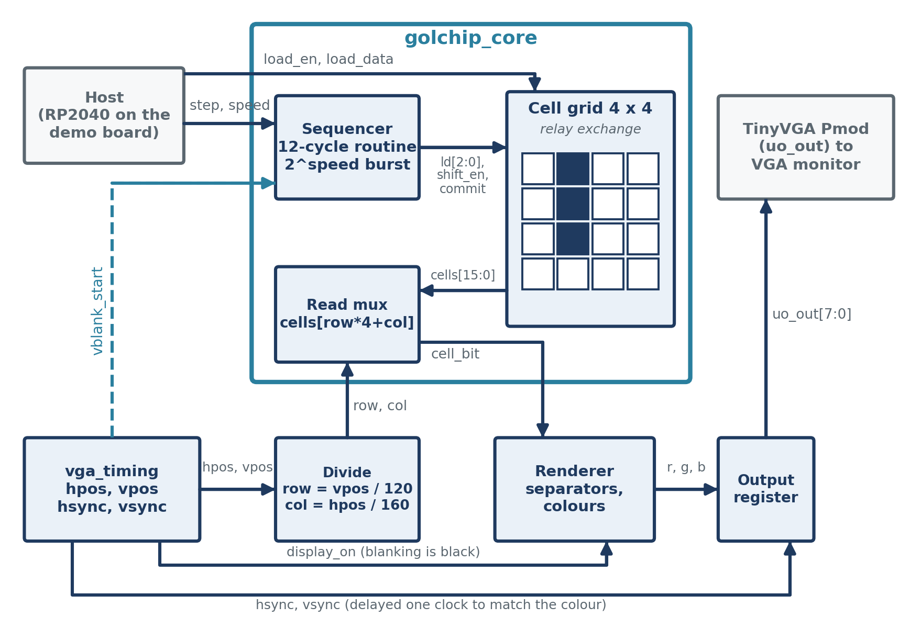
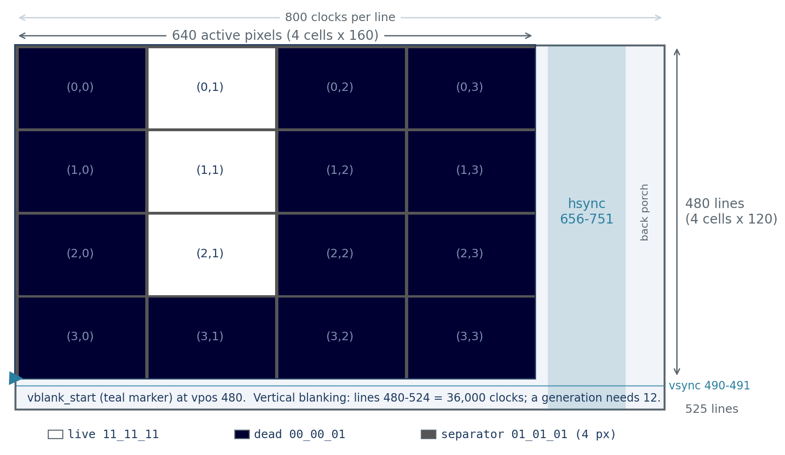

# Architecture

4×4 Game of Life (B3/S23) core with 640×480 @ 60 Hz VGA output.
Tiny Tapeout 26c, `gf180mcuD`, 1×1 tile, top module `tt_um_vga_interface`,
single 25.175 MHz clock, synchronous active-low reset.

Related: [functionality.md](functionality.md), [code_walkthrough.md](code_walkthrough.md).

## 1. Block diagram



| Module | File | Function |
|---|---|---|
| `tt_um_vga_interface` | `project.v` | Pin decode, beam → cell mapping, renderer, registered `uo_out` |
| `vga_timing` | `vga_timing.v` | `hpos`/`vpos` counters, `hsync`/`vsync`, `display_on`, `vblank_start` |
| `golchip_core` | `golchip.v` | Instantiates sequencer, grid, read mux |
| `golchip_sequencer` | `golchip.v` | Step synchroniser, burst counter, 12-phase FSM |
| `golchip_grid` | `golchip.v` | 4×4 `golchip_cell` array, padded neighbour bus, snake load chain |
| `golchip_cell` | `golchip.v` | `s`, 8-bit compaction register `sr`, relay `link` output, next-state logic |
| `golchip_readmux` | `golchip.v` | `cells[row*4+col]` |

## 2. Neighbour exchange (relay, 3 steps)

Each cell has a single output `link`, fanned out to its N/S/E/W neighbours.
No diagonal nets and no tri-states. Diagonals are relayed by the W and E
neighbours.


| Phase | Strobe | `link` drives | Loaded |
|---|---|---|---|
| 1 | `ld[0]` | `s` | `sr[3:0] <= {in_w, in_e, in_s, in_n}` |
| 2 | `ld[1]` | `sr[0]` (own N) | `sr[4] <= in_w` (NW), `sr[5] <= in_e` (NE) |
| 3 | `ld[2]` | `sr[1]` (own S) | `sr[6] <= in_w` (SW), `sr[7] <= in_e` (SE) |

`in_n`/`in_s` are ignored in phases 2–3. Bit assignment within `sr` is
arbitrary since only the population count is used.

| 4×4 grid | Direct 8-neighbour | Shared lines | Relay (built) |
|---|---|---|---|
| Inputs per cell | 8 | 4 | 4 |
| Driver→receiver connections | 84 | — | 48 |
| Diagonal routing | yes | yes | no |
| Multi-driver nets | no | yes | no |
| Exchange cycles | 4 | 4 | 3 |
| Per-cell overhead | — | tri-state enables | 3:1 mux on `link` |

## 3. Population count and next state

`sr` is compacted right for 8 cycles (`shift_en`); worst case is 7. Result is
a thermometer code of the neighbour count.

```verilog
e            = {1'b1, sr, 1'b0};
sr_packed[i] = (e[i+1] & e[i+2]) | (e[i] & ~e[i+1]);

exactly3 = sr[5] & ~sr[4];
exactly2 = sr[6] & ~sr[5];
next_s   = exactly3 | (s & exactly2);
```

`sr[6]`, `sr[5]`, `sr[4]` = count ≥ 2, ≥ 3, ≥ 4. 9 flops per cell, 144 in the
grid.

## 4. Sequencing


| Phase | Output | Cycles |
|---|---|---|
| 0 | idle; leaves on `start` | — |
| 1–3 | `ld[0..2]` | 3 |
| 4–11 | `shift_en` | 8 |
| 12 | `commit` | 1 |

`start = vblank_start & (phase==0) & ~load_en & (gens_left!=0)`.
Generation = 12 cycles; vertical blanking = 36,000 cycles, so every commit
lands in blanking. All strobes are clock enables; single clock domain.

`step` → 2-FF synchroniser → rising-edge detect. On `step_rise & ~load_en`,
`gens_left <= 2**speed` (reload, not accumulate); decremented on `commit`.
One generation per frame. `busy = (phase!=0) | (gens_left!=0)`.

## 5. Boundary

`golchip_grid` builds a 6×6 `pad` bus from `links` with a constant-0 ring.
All cell inputs index into `pad`, giving a dead border; relayed diagonals from
the ring are also 0. All-ones grid → corners only (`0x9009`) after one
generation.

## 6. Load chain


`POS = r*4 + (r even ? c : 3-c)`, `chain[0] = load_data`,
`chain[POS+1] = cells[IDX]`. While `load_en`, `s <= chain_in` (takes priority
over `commit`). 16 clocks per load; the first bit sent lands at POS 15
(cell 12). The sequencer cannot start and `step` edges are dropped during
load.

## 7. VGA path

| | H (px) | V (lines) |
|---|---|---|
| Active | 0–639 | 0–479 |
| Front porch | 16 | 10 |
| Sync (low) | 656–751 | 490–491 |
| Back porch | 48 | 33 |
| Total | 800 | 525 |

`vblank_start = (vpos==480) & (hpos==0)`.



- `col = hpos/160`, `row = vpos/120` (constant divisors, 2-bit results;
  wrap outside the active area is masked by `display_on`).
- Separators: `hpos%160 < 4` or `vpos%120 < 4`.
- Colour priority: `~display_on` → 000000; separator → 010101;
  live → 111111; dead → 000001 (RRGGBB).
- All of `uo_out` (including syncs) registered together: 1-cycle latency,
  sync/colour aligned.

## 8. Resources and unused I/O

- `uio_out = uio_oe = 0`; `ui_in[3:2]` unused; `run` (`ui_in[6]`) decoded,
  unused.
- `gen_tick`, `busy`, `cells` exist on `golchip_core` but are not pinned out.
- `clear` tied low; `rst_n` clears all state.

## 9. Open items

- Utilisation on GF180 not yet reviewed. Fallback: replace `/160`, `/120`,
  `%160`, `%120` with comparators or per-line counters.
- Confirm 25.175 MHz on the demo board.
- Review gate-level sim and STA from the GDS action.
