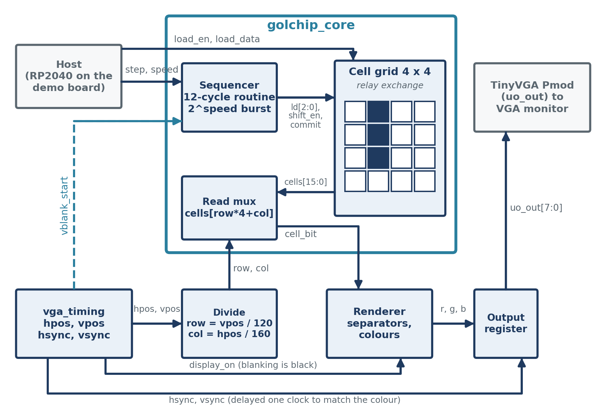
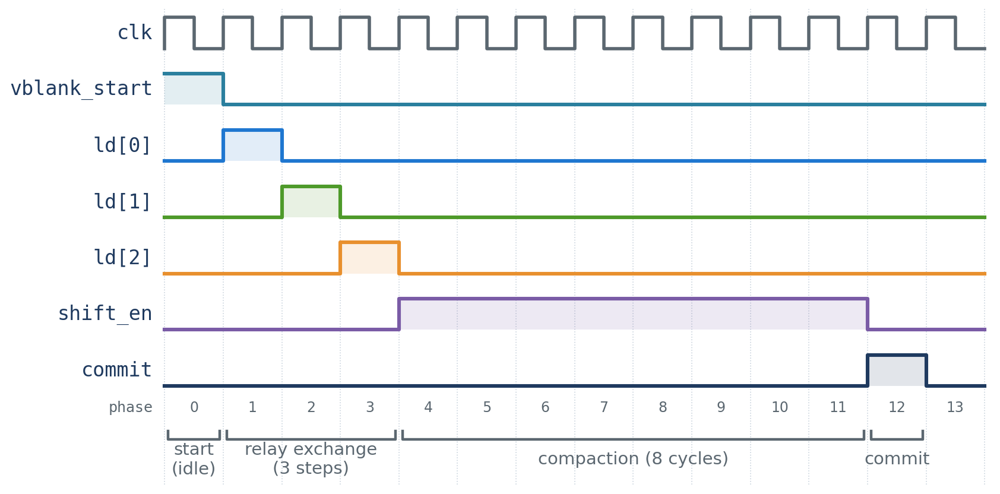
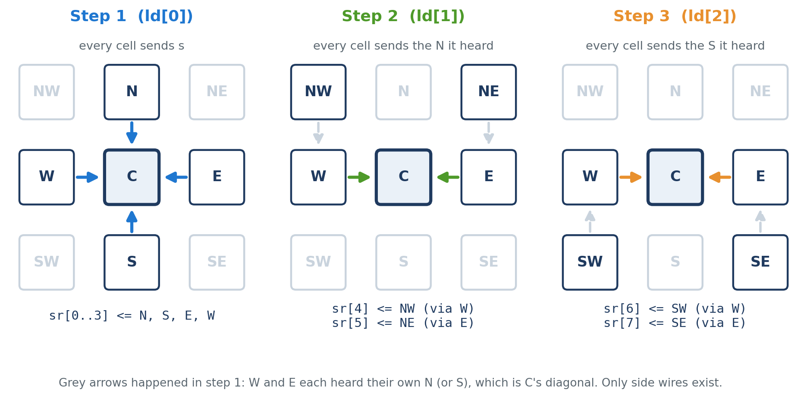

# Code Walkthrough

A guided tour of the Verilog in `src/`, file by file. Code excerpts are copied
from the source (some lines shortened with `...`).

See also: [architecture.md](architecture.md) and
[functionality.md](functionality.md).

---

## 0. Map of the code

| File | Module | Job |
|---|---|---|
| `src/project.v` | `tt_um_vga_interface` | Top level: pins in, VGA out, glues the other modules together |
| `src/vga_timing.v` | `vga_timing` | Counts pixels and lines; makes `hsync`, `vsync`, `vblank_start` |
| `src/golchip.v` | `golchip_core` | Wraps the four modules below into one block |
| | `golchip_sequencer` | Decides when each step of a generation happens |
| | `golchip_grid` | Builds the 4×4 cells and wires them together |
| | `golchip_cell` | One cell: neighbour register, counting, Life rule |
| | `golchip_readmux` | Picks the cell the monitor is drawing |



### The Verilog you need

Verilog describes hardware, not steps in a program. Everything exists at the
same time, and all `always @(posedge clk)` blocks update together on each
rising clock edge.

| Syntax | Meaning |
|---|---|
| `module ... endmodule` | One block of hardware with ports. A module used inside another is an *instance*. |
| `wire` / `assign` | A connection. `assign x = a & b;` is a gate whose output is always `a & b`. |
| `reg` + `always @(posedge clk)` | Flip-flops: the value only changes on the rising clock edge. |
| `<=` | Non-blocking assignment: every `<=` in a clocked block takes effect together, using the old values on the right. |
| `always @(*)` | Combinational logic written like code (no flip-flops). |
| `localparam`, `parameter` | Named constants; a `parameter` can be overridden per instance. |
| `generate` / `for` / `genvar` | Copies hardware at build time (e.g. once per cell). Not a loop that runs. |
| `` `ifdef SIM_FAST_FRAME `` | Code included only when that name is defined (simulation only here). |
| `` `default_nettype none `` | A misspelt signal name becomes an error instead of a silent new wire. |
| `{a, b, c}` | Concatenation: joins bits into a wider value. |

---

## 1. `project.v`: the top level

Every Tiny Tapeout project has the same ports (`ui_in`, `uo_out`, `uio_in`,
`uio_out`, `uio_oe`, `ena`, `clk`, `rst_n`) so the chip's shared wiring can
connect to any design.

### Control decode

```verilog
localparam N = 4;   // 4x4 grid
localparam W = 2;   // bits for row/col (log2 N)
wire reset = ~rst_n;
wire       step      = ui_in[7];
wire       run       = ui_in[6];   // reserved / unused
wire       load_en   = ui_in[5];
wire       load_data = ui_in[4];
wire [1:0] speed      = ui_in[1:0];
```

Just names for the input pins; no logic. `reset` is active high because
`vga_timing` expects that.

### Which cell is under the beam

```verilog
localparam CELL_W = HDISP / N;   // 160
localparam CELL_H = VDISP / N;   // 120
wire [W-1:0] col = hpos / CELL_W;
wire [W-1:0] row = vpos / CELL_H;
```

The screen is 4 columns of 160 pixels and 4 rows of 120 lines. The divisors
are constants, so synthesis builds fixed logic, not a general divider. In the
blanking area the result would be 4, which wraps to 0 in 2 bits, but those
pixels are forced black anyway. Under `SIM_FAST_FRAME` the visible area is
40×20, so cells are 10×5.

### Core instance

```verilog
golchip_core #(.N(N), .W(W)) u_core (
    ... .clear(1'b0),          // clear unused: rst_n wipes the grid
    .vblank_start(vblank_start), .row(row), .col(col),
    .cell_bit(cell_bit), ...
);
```

`#(.N(N), .W(W))` sets the core's parameters. The core takes the controls,
the `vblank_start` pulse and the beam's `row`/`col`, and returns `cell_bit`.

### Renderer

```verilog
wire on_vline = (hpos % CELL_W) < SEPW;
wire on_hline = (vpos % CELL_H) < SEPW;
always @(*) begin
    if (!display_on)        {r, g, b} = 6'b00_00_00;  // blanking must be black
    else if (on_grid_line)  {r, g, b} = 6'b01_01_01;  // dim grey separators
    else if (cell_bit)      {r, g, b} = 6'b11_11_11;  // live cell: white
    else                    {r, g, b} = 6'b00_00_01;  // dead cell: near-black blue
end
```

`%` is the remainder, so `hpos % 160` is the position inside the current cell;
the first 4 pixels on the left and top of each cell become a separator. The
`if` chain is a priority chooser.

### Output register

```verilog
always @(posedge clk) begin
    if (reset) uo_reg <= 8'b0;
    else       uo_reg <= {hsync, b[0], g[0], r[0],
                          vsync, b[1], g[1], r[1]};
end
assign uo_out  = uo_reg;
assign uio_out = 8'b0;
assign uio_oe  = 8'b0;
```

The eight video signals are packed in TinyVGA order and stored in flip-flops,
so colour and sync change on the same clock edge with no glitches. The `uio`
pins are unused inputs. A dummy `_unused` wire keeps the linter quiet about
unused inputs.

---

## 2. `vga_timing.v`: scanning the screen

A monitor draws one line at a time, one pixel per clock: 640 visible pixels
plus 160 blanking clocks per line, 480 visible lines plus 45 blank lines per
frame.

```verilog
localparam H_DISPLAY = 640;  localparam H_FRONT = 16;
localparam H_SYNC    =  96;  localparam H_BACK  = 48;
localparam H_SYNC_START = H_DISPLAY + H_FRONT;                       // 656
localparam H_SYNC_END   = H_DISPLAY + H_FRONT + H_SYNC - 1;          // 751
localparam H_MAX        = H_DISPLAY + H_FRONT + H_SYNC + H_BACK - 1; // 799
```

(and the same for vertical: 480, 10, 2, 33). `SIM_FAST_FRAME` swaps in tiny
values so a simulated frame takes a few hundred clocks instead of 420,000.

### The counters

```verilog
always @(posedge clk) begin
    if (reset)              hpos <= 10'd0;
    else if (hpos >= H_MAX) hpos <= 10'd0;
    else                    hpos <= hpos + 10'd1;
end
always @(posedge clk) begin
    if (reset) vpos <= 10'd0;
    else if (hpos >= H_MAX) begin
        if (vpos >= V_MAX) vpos <= 10'd0;
        else               vpos <= vpos + 10'd1;
    end
end
```

`hpos` counts 0–799 and wraps; `vpos` only moves when `hpos` wraps, so it
counts lines 0–524. Like the two hands of a clock.

### The outputs

```verilog
assign display_on   = (hpos < H_DISPLAY) && (vpos < V_DISPLAY);
assign hsync        = ~((hpos >= H_SYNC_START) && (hpos <= H_SYNC_END));
assign vsync        = ~((vpos >= V_SYNC_START) && (vpos <= V_SYNC_END));
assign vblank_start = (vpos == V_DISPLAY) && (hpos == 10'd0);
```

- `display_on`: 1 inside the visible area.
- `hsync`, `vsync`: 0 during the pulse (`~` inverts) — this mode uses negative sync.
- `vblank_start`: 1 for exactly one clock per frame, right after the last
  visible line. This is the core's "safe to update now" signal.

---

## 3. `golchip.v`: the Game of Life

### 3.1 `golchip_core`: the wrapper

```verilog
wire [2:0] ld;               // exchange-step enables
wire       shift_en, commit;
golchip_sequencer u_seq ( ... .ld(ld), .shift_en(shift_en), .commit(commit), .busy(busy) );
golchip_grid #(.N(N)) u_grid ( ... .ld(ld), .shift_en(shift_en), .commit(commit), .cells(cells) );
golchip_readmux #(.N(N), .W(W)) u_mux ( .cells(cells), .row(row), .col(col), .cell_bit(cell_bit) );
assign gen_tick = commit;
```

No logic of its own. The sequencer's five control signals go to every cell at
once; the grid outputs all 16 states on `cells`; the read mux picks one.

### 3.2 `golchip_sequencer`: when things happen



**Catching the step button**

```verilog
wire step_rise = step_sync[1] & ~step_prev;
...
step_sync <= {step_sync[0], step};
step_prev <= step_sync[1];
```

`step` comes from a pin that can change at any time. Two flip-flops give a
clean clocked copy; `step_prev` remembers last cycle's value, so `step_rise`
is 1 for exactly one clock per press (holding it high counts once).

**How many generations**

```verilog
case (speed)
    2'd0: burst_len = 4'd1;   2'd1: burst_len = 4'd2;
    2'd2: burst_len = 4'd4;   default: burst_len = 4'd8;
endcase
...
if (step_rise && !load_en)            gens_left <= burst_len;
else if (commit && gens_left != 4'd0) gens_left <= gens_left - 4'd1;
```

A press loads 2^`speed` into `gens_left` (not while loading); each `commit`
counts down. A press during a burst loads a fresh count.

**Starting and stepping**

```verilog
wire start = vblank_start && (phase == 4'd0) && !load_en && (gens_left != 4'd0);
if (start)               phase <= 4'd1;
else if (phase == LAST)  phase <= 4'd0;     // LAST = 12
else if (phase != 4'd0)  phase <= phase + 4'd1;
```

A generation starts only when the screen just entered blanking, nothing is
running, nothing is loading, and work is left. `phase` counts 1…12 and returns
to 0, so a burst of 8 runs one generation per frame for 8 frames.

**Control signals**

```verilog
assign ld[0]    = (phase == 4'd1);
assign ld[1]    = (phase == 4'd2);
assign ld[2]    = (phase == 4'd3);
assign shift_en = (phase >= 4'd4) && (phase <= 4'd11);
assign commit   = (phase == LAST);
assign busy     = (phase != 0) || (gens_left != 0);
```

Reset zeroes `phase`, `gens_left` and the step flip-flops. `run` is wired in
but unused (reserved for a free-running mode).

### 3.3 `golchip_grid`: building and wiring the cells

**The padded copy (dead border)**

```verilog
localparam P = N + 2;            // padded width (6)
wire [N*N-1:0] links;            // each cell's one output wire
wire [P*P-1:0] pad;              // links with a dead ring around them
if (r == 0 || c == 0 || r == P-1 || c == P-1)
    assign pad[r*P + c] = 1'b0;                     // border: always 0
else
    assign pad[r*P + c] = links[(r-1)*N + (c-1)];   // a real cell
```

Every cell reads its neighbours from the 6×6 `pad`, so an edge cell just reads
0 where there is no neighbour. No special cases for edges or corners.

**Placing each cell**

```verilog
localparam integer IDX = r*N + c;                              // cell number
localparam integer POS = r*N + ((r % 2 == 0) ? c : (N-1-c));  // place in load chain
localparam integer PR  = r + 1;  localparam integer PC = c + 1;
golchip_cell u_cell (
    .chain_in (chain[POS]),
    .in_n (pad[(PR-1)*P + PC    ]),   // from the cell above
    .in_s (pad[(PR+1)*P + PC    ]),   // from the cell below
    .in_e (pad[ PR   *P + PC + 1]),   // from the cell to the right
    .in_w (pad[ PR   *P + PC - 1]),   // from the cell to the left
    .link (links[IDX]), .s (cells[IDX]), ...
);
assign chain[POS+1] = cells[IDX];
```

- `IDX`: the cell's index in `cells` and `links` (row 0 = top, column 0 = left).
- `PR, PC`: the same cell in the padded grid. Up is `PR-1`, right is `PC+1`, …
- `POS`: place in the load chain; odd rows are reversed, so the chain snakes.
- `chain[0]` is `load_data`; each cell takes `chain[POS]` and drives
  `chain[POS+1]` with its state, so every bit moves one place per clock.

### 3.4 `golchip_cell`: one cell

**What the cell sends**

```verilog
assign link = ld[1] ? sr[0]     // step 2: the N value I heard
            : ld[2] ? sr[1]     // step 3: the S value I heard
            :         s;        // otherwise: my own state
```

A 3-way switch. Normally the cell shows its own state; in steps 2 and 3 it
forwards what it heard from above and below. That is how neighbours learn
their diagonals without diagonal wires.



**Collecting the neighbours**

```verilog
if (ld[0]) begin  sr[0] <= in_n; sr[1] <= in_s; sr[2] <= in_e; sr[3] <= in_w;  end
if (ld[1]) begin  sr[4] <= in_w;  sr[5] <= in_e;  end   // W's N = my NW, E's N = my NE
if (ld[2]) begin  sr[6] <= in_w;  sr[7] <= in_e;  end   // W's S = my SW, E's S = my SE
```

N and S inputs are ignored in steps 2 and 3. After three steps `sr` holds all
eight neighbours.

**Counting without an adder**

```verilog
wire [9:0] e = {1'b1, sr, 1'b0};
assign sr_packed[i] = (e[i+1] & e[i+2])    // a 1 that is blocked stays
                    | (e[i]   & ~e[i+1]);  // an empty stage takes the 1 from its left
```

`e` is `sr` with a 0 wall on the left and a 1 wall on the right. `e[i+1]` is
`sr[i]`, `e[i]` the stage to its left, `e[i+2]` the stage to its right. Each
`shift_en` cycle (`sr <= sr_packed`) slides every 1 right if there is room;
after at most 7 cycles *k* neighbours means the right-most *k* bits are 1
(e.g. `00000111` for 3).

**The Life rule**

```verilog
wire exactly3 = sr[5] & ~sr[4];
wire exactly2 = sr[6] & ~sr[5];
wire next_s   = exactly3 | (s & exactly2);
```

`sr[6]` = at least 2, `sr[5]` = at least 3, `sr[4]` = at least 4. Alive next
if exactly 3, or already alive with exactly 2.

**The registers**

```verilog
always @(posedge clk) begin
    if (!rst_n || clear) begin s <= 1'b0; sr <= 8'b0; end
    else begin
        if (shift_en) sr <= sr_packed;
        else begin /* the three ld steps above */ end
        if (load_en)     s <= chain_in;
        else if (commit) s <= next_s;
    end
end
```

`s` only changes while loading (copies the previous cell in the chain) or on
`commit`. Every cell commits on the same clock, so none sees a neighbour that
already updated.

### 3.5 `golchip_readmux`

```verilog
assign cell_bit = cells[row*N + col];
```

Row and column give the cell number; that bit is the output.

---

## 4. One step press, through the code

| When | Where | What happens |
|---|---|---|
| Press | `golchip_sequencer` | `step_sync` copies the pin; `step_rise` pulses; `gens_left` = 2^speed |
| Up to one frame later | `vga_timing` | beam finishes line 479; `vblank_start` pulses |
| Same clock | `golchip_sequencer` | `start` is true; `phase` → 1 |
| Phases 1–3 | `golchip_cell` | `link` switches between `s`, `sr[0]`, `sr[1]`; `sr` fills with all eight neighbours |
| Phases 4–11 | `golchip_cell` | `sr <= sr_packed` packs the 1s right |
| Phase 12 | cell, sequencer | `commit`: every `s` takes `next_s`; `gens_left` counts down; `phase` → 0 |
| Next frame | `project.v` | `row`/`col` sweep the screen; the new generation is drawn |

---

## 5. The test code

- `test/tb.v`: a wrapper with the chip's pins and no logic. cocotb drives its
  inputs and reads its outputs (and it connects power pins for gate-level runs).
- `test/test.py`: 21 cocotb tests. Each `@cocotb.test()` async function starts
  a 25 MHz clock, sets pins, waits for edges or frames, and checks outputs
  against a Python Game of Life model.
- `test/tb_selfcheck.v`: a standalone Icarus testbench for a quick timing check
  without cocotb.

Run with `make -B` in `test/` (add `GUI_FAST_FRAME=1 COMPILE_ARGS+=-DSIM_FAST_FRAME`
for the fast frame).
